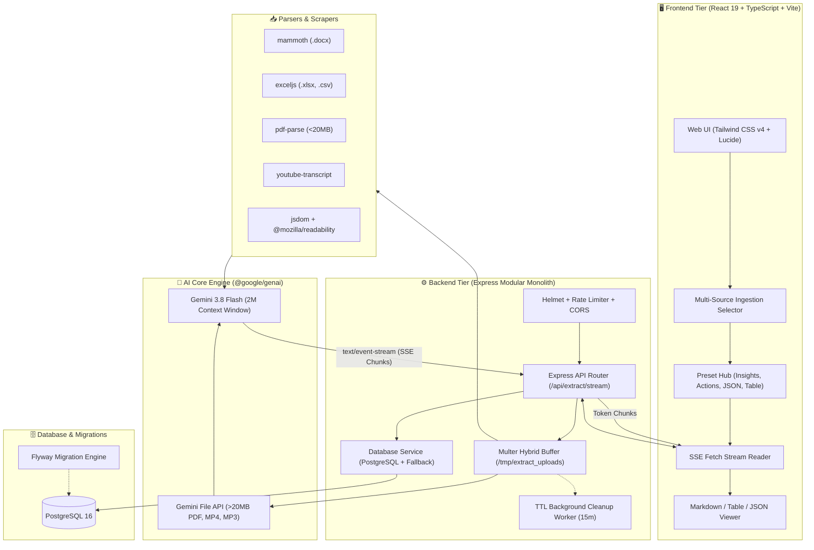

# 🚀 All-in-One AI Information Extractor

> Nền tảng Full-Stack trích xuất, tóm tắt và cấu trúc hóa dữ liệu đa nguồn (Multi-source & Multimodal Ingestion) ứng dụng mô hình **Gemini 3.8 Flash** với cửa sổ ngữ cảnh khổng lồ 2M+ tokens và Gemini File API.

---

## 🌟 Tính Năng Nổi Bật

- **🎨 Giao Diện Manabi Hiện Đại, Tươi Sáng & Ấm Áp:**
  - Thiết kế theo phong cách nền tảng học tập thông minh **Manabi** dành cho giới trẻ, học sinh, sinh viên.
  - Tông màu chủ đạo kem ấm (`Warm Cream / Terracotta #B85028`) với font chữ bo tròn hiện đại `Plus Jakarta Sans`.
  - **Đổi Màu Background (6 Theme Presets)**:
    1. 🌾 *Kem ấm / Terracotta* (Manabi Default)
    2. ☁️ *Trắng xanh hiện đại (Clean Sky White)*
    3. 🍵 *Xanh Matcha (Matcha Sage)*
    4. 🌸 *Hồng Đào (Rose Peach)*
    5. 💜 *Tím Hoàng Hôn (Sunset Lilac)*
    6. ☕ *Nâu Cà Phê Tối (Cozy Espresso Dark)*
  - **Chuyển Đổi Ngôn Ngữ Song Ngữ (i18n)**: 🇻🇳 Tiếng Việt & 🇬🇧 English linh hoạt chỉ với 1 click tại header.

- **📑 Thanh Điều Hướng Sidebar Đầy Đủ Phân Hệ:**
  - Bỏ thanh navbar ngang cũ, thay bằng **Left Sidebar** chuyên nghiệp phân nhóm chức năng:
    - **Explore**: Khám phá kiến thức
    - **CONTENT CREATION**: *Materials*, *Quizzes* (giao diện chính), *Flashcards*, *Collections*
    - **STUDY TOOLS**: *Notes*, *Reader*, *Tutors (Gia sư AI)*, *Pomodoro (Đồng hồ tập trung)*
    - **PLANNING & ORGANIZATION**: *Planner*, *Kanban Board (Bảng kế hoạch)*
    - **SOCIAL & PROGRESS**: *Study Groups*, *Achievements*, *Statistics*
    - **ACCOUNT**: *Settings*, *User Profile*

- **🔐 Hệ Thống Xác Thực Đầy Đủ Với JWT & Google Sign-In:**
  - Đăng ký tài khoản (Họ tên, email, mật khẩu mã hóa bằng `bcryptjs`).
  - Đăng nhập bảo mật với JSON Web Token (JWT).
  - Đăng nhập 1-click bằng tài khoản Google.
  - Quên mật khẩu & gửi mã token khôi phục mật khẩu.
  - Quản lý session lưu trữ an toàn trong `localStorage` và gửi qua `Authorization: Bearer <token>`.

- **🎯 Studio Tạo Đề Trắc Nghiệm & Trích Xuất AI (Generate Quiz Studio):**
  - **8 Nguồn Ingestion Đầu Vào**: File (PDF, Word, Excel), Text (văn bản thuần), Link (bài viết web), Drive, Material, Media (ghi âm), Image (scan OCR), YouTube (video transcript).
  - Khung tải lên kéo thả (Dotted Dropzone) thân thiện.
  - **Thanh Điều Khiển Bên Phải**: Quyền riêng tư (Private/Public), Ngôn ngữ kết quả, Dạng câu hỏi (Mixed, MCQ, Insights, Actions, JSON, SWOT), Độ khó (Easy/Medium/Hard), Parsing Mode (Fast, Balanced, Premium).
  - Hộp thông báo màu vàng trực quan ghi chú về cơ chế phân tích dữ liệu.

- **📱 Chế Độ Xem Kết Quả Tương Tác:**
  - **Đề Trắc Nghiệm Tương Tác (Interactive Quiz)**: Hiển thị từng câu hỏi dạng A/B/C/D có thể chọn đáp án, bấm "Xem đáp án & giải thích", chấm điểm trực quan!
  - **Bản Đọc Markdown**: Định dạng phong phú, danh sách, công thức.
  - **Bảng Dữ Liệu (Interactive Table)**: Tìm kiếm lọc dữ liệu, sắp xếp cột, xuất file CSV.
  - **Mã JSON**: Hiển thị code JSON chuẩn RFC 8259.
  - Đo lường thời gian thực **Time-to-First-Token (TTFT < 500ms)** và số lượng Tokens sử dụng.

- **Quản Lý Cơ Sở Dữ Liệu Với PostgreSQL & Flyway:**
  - Flyway migrations quản lý version database tự động (`db/migration/V1__create_extractions_table.sql`).
  - Ghi nhận lịch sử trích xuất, telemetry và nội dung vào bảng `extractions`.
  - Cơ chế **Resilient Fallback**: Tự động chuyển sang in-memory store nếu PostgreSQL đang khởi động hoặc chưa kết nối.

- **Bảo Mật & Zero-Disk-Leak:**
  - Khóa API `GEMINI_API_KEY` chỉ tồn tại ở Server-side, tuyệt đối không lộ client.
  - Rate limiting (30 requests / 15 phút), Helmet security headers, CORS strict.
  - Background worker TTL chạy mỗi 15 phút dọn sạch các tệp tạm > 30 phút.
  - Xóa file tạm ngay lập tức trong `finally {}` và khi server tắt (`SIGINT`/`SIGTERM`).

---

## 🏗️ Kiến Trúc Hệ Thống (Modular Monolith)



---

## 🛠️ Công Nghệ Sử Dụng (Tech Stack)

| Hạng Mục | Công Nghệ |
| :--- | :--- |
| **Frontend** | React 19, TypeScript (Strict Mode), Vite 6+, Tailwind CSS v4, `motion`, `lucide-react`, `zustand`, `@tanstack/react-query` |
| **Backend** | Node.js 22 LTS, Express.js (Modular Monolith), `tsx`, `multer`, `helmet`, `cors`, `express-rate-limit` |
| **AI SDK** | `@google/genai` (SDK chính thức mới nhất), Model `gemini-3.8-flash`, Gemini File API |
| **Parsers** | `pdf-parse`, `mammoth`, `exceljs`, `youtube-transcript`, `axios`, `jsdom`, `@mozilla/readability`, `cheerio` |
| **Database** | PostgreSQL 16, Flyway Migration Tools |
| **Testing** | Vitest 3+, Supertest |
| **DevOps** | Docker (Multi-stage build), Docker Compose |

---

## 🚀 Cài Đặt & Chạy Ứng Dụng

### 1. Chuẩn Bị Môi Trường
Đảm bảo bạn đã cài đặt Node.js 20+ hoặc 22 LTS và npm:
```bash
node -v
npm -v
```

### 2. Cài Đặt Dependencies
```bash
npm install
```

### 3. Cấu Hình Biến Môi Trường (`.env`)
Tạo hoặc chỉnh sửa tệp `.env`:
```env
PORT=3000
NODE_ENV=development

# Khóa Google Gemini API (Lấy từ Google AI Studio)
GEMINI_API_KEY=your_gemini_api_key_here
GEMINI_MODEL=gemini-3.8-flash

# Cấu hình PostgreSQL (Flyway migrations)
DB_HOST=localhost
DB_PORT=5432
DB_NAME=ai_info_extractor
DB_USER=postgres
DB_PASSWORD=postgres

# Thư mục tạm
TEMP_DIR=/tmp/extract_uploads
```

### 4. Chạy Ở Môi Trường Development
Khởi chạy cả Backend Express và Frontend Vite HMR qua 1 lệnh duy nhất:
```bash
npm run dev
```
Truy cập ứng dụng tại: **[http://localhost:3000](http://localhost:3000)**

### 5. Chạy Kiểm Thử (Unit & Integration Tests)
```bash
npm test
```

### 6. Build Production Bundle
```bash
npm run build
npm start
```

---

## 🐳 Triển Khai Bằng Docker & Docker Compose

Ứng dụng đi kèm cấu hình Docker đa tầng tối ưu (Multi-stage build) và Docker Compose khởi tạo trọn gói PostgreSQL, Flyway migrations và App server:

```bash
# Khởi chạy toàn bộ hệ thống (PostgreSQL + Flyway + App)
docker compose up --build -d
```
Xem log hoạt động:
```bash
docker compose logs -f app
```

---

## 📋 API Endpoints

- `GET /api/health`: Kiểm tra trạng thái máy chủ, uptime, kết nối database, và mô hình Gemini.
- `GET /api/presets`: Lấy danh sách 5 preset chuẩn và câu lệnh prompt mẫu.
- `GET /api/history`: Lấy danh sách lịch sử các lần trích xuất gần nhất.
- `GET /api/history/:id`: Xem chi tiết 1 lần trích xuất.
- `DELETE /api/history/:id`: Xóa một bản ghi lịch sử.
- `POST /api/extract/stream`: Luồng xử lý đa nguồn Server-Sent Events (SSE) trả kết quả thời gian thực.
